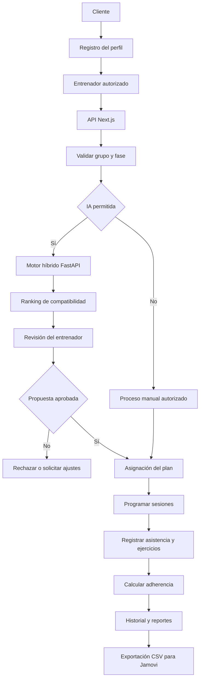

# EVOLUTION CENTER FIT 2.0

**Sistema inteligente de recomendación de rutinas de ejercicio y seguimiento de la adherencia al plan de entrenamiento**

Proyecto académico de desarrollo de software — Lima, Perú.

**Última actualización:** 7 de noviembre de 2026  
**Avance documentado:** FASE 108.2 — Verificación de seguridad  
**Estado:** Prototipo académico funcional, desplegado en la nube y en proceso de validación integral.

---

## 1. Descripción general

**Evolution Center Fit 2.0** es una plataforma web orientada a la gestión del entrenamiento físico mediante recomendaciones inteligentes de rutinas, supervisión de entrenadores y seguimiento de la adherencia de los clientes.

El sistema permite registrar perfiles físico-contextuales, evaluar la compatibilidad de rutinas, revisar recomendaciones, asignar planes de entrenamiento, programar sesiones y registrar evidencias de ejecución.

Además, incorpora herramientas para analizar tres dimensiones de la adherencia:

1. Asistencia a sesiones programadas.
2. Cumplimiento de ejercicios y series.
3. Continuidad del plan de entrenamiento.

La plataforma funciona mediante una arquitectura distribuida que integra **Next.js, Supabase, PostgreSQL, Python, FastAPI, Vercel y Render**.

El motor de recomendación no sustituye al entrenador. Las propuestas generadas deben ser revisadas y aprobadas por un profesional autorizado antes de su asignación.

> **Aviso académico:** El sistema constituye un prototipo funcional desplegado para pruebas controladas. Su publicación en Vercel no demuestra por sí misma que haya superado una auditoría de seguridad completa ni que la herramienta haya demostrado científicamente mejorar la adherencia. Los registros demostrativos no deben considerarse resultados reales de investigación.

---

## 2. Información del proyecto

| Elemento | Descripción |
|---|---|
| Nombre | Evolution Center Fit 2.0 |
| Tipo | Aplicación web |
| Finalidad | Recomendación inteligente y seguimiento de entrenamientos |
| Metodología de desarrollo | Scrum |
| Metodología de investigación | Cuantitativa, aplicada y cuasiexperimental |
| Frontend | Next.js 16.4.4, React, TypeScript y Tailwind CSS |
| Backend web | API Routes de Next.js |
| Motor inteligente | Python y FastAPI |
| Base de datos | PostgreSQL |
| Autenticación | Supabase Auth |
| Seguridad de datos | Row Level Security (RLS) y funciones SQL |
| Frontend desplegado | Vercel |
| Servicio inteligente desplegado | Render |
| Repositorio | GitHub |
| Zona horaria operativa | America/Lima |

### 2.1. Enlaces del proyecto

**Aplicación en producción:**

https://evolution-center-fit-2.vercel.app

**Inicio de sesión:**

https://evolution-center-fit-2.vercel.app/login

**Repositorio GitHub:**

https://github.com/rojasbilly95-debug/evolution-center-fit-2

**Panel del entrenador:**

https://evolution-center-fit-2.vercel.app/entrenador

**Reporte de investigación:**

https://evolution-center-fit-2.vercel.app/entrenador/investigacion/reporte

El servicio FastAPI se encuentra desplegado en Render. Su dirección se configura mediante la variable privada `IA_SERVICE_URL`.

---

## 3. Estado actual del desarrollo

### 3.1. Funcionalidades implementadas

| Módulo | Estado |
|---|---|
| Inicio de sesión mediante Supabase | Implementado |
| Roles de cliente, entrenador y administrador | Implementados |
| Gestión del perfil del cliente | Implementada |
| Catálogo de rutinas y ejercicios | Implementado |
| Asociación entre entrenador y cliente | Implementada |
| Motor híbrido de recomendación | Implementado |
| Evaluación de compatibilidad de rutinas | Implementada |
| Revisión y aprobación del entrenador | Implementada |
| Asignación de rutinas aprobadas | Implementada |
| Asignación manual para el estudio | Implementada |
| Programación de sesiones | Verificada |
| Control de asistencia | Implementado; pruebas integrales pendientes |
| Registro de ejercicios y series | Implementado; pruebas integrales pendientes |
| Resumen de cumplimiento | Implementado |
| Indicadores de adherencia | Implementados |
| Continuidad semanal | Implementada |
| Historial de planes de entrenamiento | Visualizado en Vercel |
| Cierre supervisado de planes | Interfaz verificada en Vercel |
| Cierre automático mediante pg_cron | Configurado; ejecución real pendiente |
| Restricción de IA para GE y GC | Implementada en el servidor |
| Exportación CSV para Jamovi | Estructura y descarga verificadas |
| Panel administrativo | Implementación inicial |
| Auditoría de seguridad | FASE 108.2 en desarrollo |
| Pruebas automatizadas web | Pendientes |

### 3.2. Estado del despliegue

La aplicación se encuentra alojada en Vercel y conectada a GitHub mediante la rama `main`.

**Commits recientes:**

| Commit | Descripción |
|---|---|
| `c0933b6` | Mostrar historial de planes de entrenamiento |
| `7fca12d` | Implementar cierre supervisado y auditable de planes |
| `6bc0efa` | Corregir restricciones de IA para grupos GE y GC |

El despliegue del commit `7fca12d` fue observado en Vercel con estado **Production / Ready**.

El commit `6bc0efa` fue enviado correctamente a GitHub, rama `main`, con compilación local satisfactoria. Su estado específico de despliegue en Vercel debe verificarse independientemente.

---

## 4. Objetivos

### 4.1. Objetivo general

Desarrollar una herramienta inteligente de recomendación de rutinas de ejercicio que permita analizar su influencia en la adherencia al plan de entrenamiento en clientes de un gimnasio.

### 4.2. Objetivos funcionales

1. Administrar usuarios mediante autenticación y roles.
2. Registrar perfiles físico-contextuales de los clientes.
3. Gestionar un catálogo de ejercicios y rutinas.
4. Asociar clientes con entrenadores autorizados.
5. Evaluar la compatibilidad entre perfiles y rutinas.
6. Generar recomendaciones personalizadas mediante un motor híbrido.
7. Permitir la revisión, aprobación o rechazo de las recomendaciones.
8. Asignar rutinas aprobadas a los clientes.
9. Programar sesiones según la frecuencia del plan.
10. Registrar asistencia, ausencias, cancelaciones y duración real.
11. Registrar el cumplimiento de ejercicios y series.
12. Calcular indicadores de asistencia, cumplimiento y continuidad.
13. Consultar resultados e historial de entrenamiento.
14. Exportar información estructurada para análisis estadístico.
15. Proteger los datos mediante autenticación, autorización, RLS y funciones SQL.
16. Diferenciar el funcionamiento de los grupos experimental y control.
17. Implementar mecanismos supervisados y automáticos para el cierre de planes.

---

## 5. Arquitectura tecnológica

Evolution Center Fit 2.0 utiliza una arquitectura distribuida en la nube.

### 5.1. Frontend

Desarrollado con:

- Next.js 16.4.4.
- React.
- TypeScript.
- Tailwind CSS.
- App Router.

Responsabilidades:

- Mostrar las interfaces.
- Gestionar navegación y formularios.
- Presentar rutinas, sesiones e indicadores.
- Proporcionar herramientas de trabajo al entrenador.
- Permitir la consulta de información del cliente.
- Comunicarse con los endpoints protegidos del servidor.

### 5.2. Backend web

Las API de Next.js se encargan de:

- Validar sesiones autenticadas.
- Verificar roles.
- Comprobar relaciones entrenador-cliente.
- Validar parámetros.
- Consultar y actualizar datos autorizados.
- Comunicarse con el servicio FastAPI.
- Ejecutar funciones PostgreSQL.
- Devolver respuestas controladas.

### 5.3. Motor inteligente

Desarrollado con Python y FastAPI.

El motor combina:

- Reglas de elegibilidad.
- Evaluación de atributos de rutinas.
- Cálculo de compatibilidad.
- Similitud de perfiles.
- Lógica difusa.
- Clasificación y ranking.

El motor está desplegado como servicio independiente en Render.

Los puntajes de compatibilidad son resultados técnicos del algoritmo. No representan probabilidades clínicas ni constituyen evidencia de eficacia científica.

### 5.4. Base de datos

Supabase proporciona:

- PostgreSQL.
- Supabase Auth.
- Políticas RLS.
- Funciones SQL.
- Restricciones de integridad.
- Relaciones entre usuarios.
- Almacenamiento de recomendaciones.
- Registro de planes y sesiones.
- Datos para seguimiento de adherencia.

### 5.5. Flujo general



Las recomendaciones inteligentes requieren revisión humana antes de su asignación.

---

## 6. Metodología de desarrollo

El proyecto utiliza **Scrum**, organizando el desarrollo en incrementos funcionales.

### Sprint 1 — Fundamentos

- Autenticación.
- Roles.
- Protección de rutas.
- Perfil del cliente.
- Catálogo de rutinas.
- Relación entrenador-cliente.

**Estado:** Funcionalidades principales implementadas.

### Sprint 2 — Motor inteligente

- Creación de FastAPI.
- Reglas de elegibilidad.
- Motor de compatibilidad.
- Similitud de perfiles.
- Lógica difusa.
- Ranking de recomendaciones.
- Integración con Next.js.

**Estado:** Motor implementado y probado parcialmente.

### Sprint 3 — Supervisión y entrenamiento

- Revisión de recomendaciones.
- Aprobación y rechazo.
- Asignación de rutinas.
- Programación de sesiones.
- Control de asistencia.
- Registro de ejercicios.
- Registro de series.

**Estado:** Programación verificada; pruebas integrales del ciclo de ejecución pendientes.

### Sprint 4 — Adherencia, seguridad y despliegue

- Resúmenes de asistencia.
- Indicadores de cumplimiento.
- Continuidad semanal.
- Reportes CSV.
- Restricciones GE/GC.
- Cierre de planes.
- Historial.
- Despliegue en Vercel.
- Auditoría RLS y funciones SQL.

**Estado:** Implementación avanzada; seguridad y pruebas de aceptación en proceso.

---

## 7. Investigación asociada

### 7.1. Título

**Herramienta inteligente de recomendación de rutinas de ejercicio y su influencia en la adherencia al plan de entrenamiento en clientes de un gimnasio.**

### 7.2. Enfoque metodológico

| Elemento | Descripción |
|---|---|
| Enfoque | Cuantitativo |
| Tipo | Aplicada |
| Alcance | Correlacional-explicativo |
| Diseño | Cuasiexperimental |
| Grupos | Experimental (GE) y control (GC) |
| Evaluación | Pretest y postest |
| Duración | 12 semanas |

### 7.3. Variables

**Variable independiente:**

Uso de la herramienta inteligente de recomendación de rutinas de ejercicio.

**Variable dependiente:**

Adherencia al plan de entrenamiento.

**Dimensiones de la variable dependiente:**

1. Asistencia a sesiones programadas.
2. Cumplimiento de la rutina.
3. Continuidad del plan de entrenamiento.

### 7.4. Diseño experimental

El estudio contempla:

- GE: grupo experimental.
- GC: grupo control.
- O1 y O3: mediciones iniciales.
- X: intervención mediante la herramienta inteligente.
- O2 y O4: mediciones posteriores.

Representación:

```text
GE: O1 ─── X ─── O2

GC: O3 ──────── O4
```

El diseño no contempla una asignación estrictamente aleatoria de los participantes.

### 7.5. Cronograma de investigación

| Etapa | Semanas | Fechas |
|---|---|---|
| Pretest | 1–4 | 09/11/2026 al 06/12/2026 |
| Intervención | 5–8 | 07/12/2026 al 03/01/2027 |
| Postest | 9–12 | 04/01/2027 al 31/01/2027 |

**Durante el pretest:**

GE y GC trabajan sin recomendaciones inteligentes.

**Durante la intervención:**

GE utiliza recomendaciones inteligentes supervisadas por el entrenador.

GC continúa utilizando el procedimiento manual.

**Durante el postest:**

Se realizan las mediciones finales de adherencia. La implementación actual permite continuar con IA supervisada para GE desde la semana 5; no incorpora un bloqueo adicional después de la semana 8.

### 7.6. Consideración metodológica

Las mediciones pretest corresponden a las semanas 1–4.

Las mediciones postest corresponden a las semanas 9–12.

Los resultados deberán obtenerse de registros auténticos de entrenamiento y no de datos ficticios.

---

## 8. Datos de demostración

El sistema dispone de dos clientes de demostración utilizados para verificar funcionalidades.

| Característica | Grupo experimental | Grupo control |
|---|---|---|
| Nombre | Cliente Demo | Cliente Control Demo |
| Grupo | GE | GC |
| Asignación | #1 | #2 |
| Rutina | Acondicionamiento inicial — Gimnasio 4 días | Resistencia inicial — Gimnasio 3 días |
| Frecuencia | 4 días/semana | 3 días/semana |
| Inicio | 09/11/2026 | 09/11/2026 |
| Fin | 06/12/2026 | 06/12/2026 |
| Sesiones programadas | 16 | 12 |
| Sesiones realizadas | 0 | 0 |
| Ausencias registradas | 0 | 0 |
| Sesiones en curso | 0 | 0 |
| Ejercicios preparados | 96 | 48 |
| Series objetivo | 256 | 96 |

**Totales de demostración:**

- 2 clientes.
- 2 planes.
- 28 sesiones programadas.
- 144 registros de ejercicios preparados.
- 352 series objetivo preparadas.

Las series objetivo representan metas del entrenamiento, no series efectivamente realizadas.

Los dos clientes son demostrativos. Sus registros no deben presentarse como resultados científicos de la investigación.

---

## 9. Roles del sistema

### 9.1. Cliente

El cliente puede:

- Iniciar sesión.
- Consultar su perfil.
- Actualizar los datos permitidos.
- Visualizar su rutina asignada.
- Consultar sesiones programadas.
- Revisar el calendario.
- Consultar información de ejercicios.
- Visualizar sus indicadores personales.

Rutas principales:

```text
/cliente
/cliente/perfil
/cliente/mi-rutina
```

### 9.2. Entrenador

El entrenador puede:

- Consultar clientes asignados.
- Evaluar perfiles.
- Solicitar recomendaciones autorizadas.
- Revisar rutinas.
- Aprobar o rechazar propuestas.
- Asignar planes.
- Programar sesiones.
- Registrar asistencia.
- Registrar ejercicios y series.
- Consultar cumplimiento.
- Analizar adherencia.
- Consultar planes históricos.
- Revisar y solicitar el cierre de planes vencidos.
- Exportar reportes de investigación.

Rutas principales:

```text
/entrenador
/entrenador/clientes
/entrenador/clientes/[clienteId]/seguimiento
/entrenador/investigacion
/entrenador/investigacion/asignacion-manual
/entrenador/investigacion/reporte
```

### 9.3. Administrador

El sistema dispone de un panel administrativo inicial:

```text
/administrador
```

La gestión administrativa integral de usuarios, entrenadores, catálogos y auditorías continúa como funcionalidad pendiente de ampliación.

---

## 10. Motor híbrido de recomendación

### 10.1. Datos de entrada

El motor considera atributos como:

- Edad.
- Índice de masa corporal (IMC).
- Objetivo de entrenamiento.
- Nivel de experiencia.
- Frecuencia semanal.
- Tiempo disponible.
- Lugar de entrenamiento.
- Equipamiento.
- Restricciones registradas.

### 10.2. Procesamiento

**Elegibilidad**

Filtra rutinas según condiciones obligatorias de nivel, duración, equipamiento y lugar.

**Compatibilidad**

Evalúa la correspondencia entre los atributos de la rutina y el perfil.

**Similitud**

Compara características relevantes entre perfiles y alternativas.

**Lógica difusa**

Permite representar niveles graduales de compatibilidad.

**Ranking**

Organiza las rutinas según los resultados obtenidos.

### 10.3. Validación técnica inicial

En pruebas anteriores, el motor FastAPI superó **17 pruebas unitarias**.

Se verificaron escenarios relacionados con:

- Compatibilidad de rutinas.
- Objetivos incompatibles.
- Equipamiento insuficiente.
- Nivel superior al permitido.
- Frecuencia incorrecta.
- Duración incompatible.
- Rutinas no publicadas.
- Lugar de entrenamiento incompatible.

Las pruebas funcionales no constituyen validación científica del efecto del recomendador sobre la adherencia.

---

## 11. Restricciones de IA por grupo de investigación

Archivo:

```text
lib/investigacion/bloqueo-ia-estudio.ts
```

La función principal es:

```typescript
bloqueoIAEstudio(clienteId)
```

### 11.1. Reglas implementadas

| Condición | Respuesta |
|---|---|
| Cliente sin inscripción verificada | Bloqueado — HTTP 403 |
| Grupo control (GC) | Bloqueado — HTTP 403 |
| Grupo experimental antes de semana 5 | Bloqueado — HTTP 403 |
| Grupo desconocido | Acceso rechazado |
| Grupo experimental desde semana 5 | Permitido por la regla temporal |
| Error al consultar Supabase | Acceso denegado |

### 11.2. Seguridad del servidor

El control se utiliza en las rutas de recomendaciones y asignación correspondientes.

La restricción se implementa en el servidor y no depende únicamente de ocultar botones.

Se utiliza la zona horaria:

```text
America/Lima
```

La versión corregida eliminó una validación duplicada de inscripción y distingue explícitamente al GC mediante una respuesta HTTP 403.

**Commit de la corrección:**

```text
6bc0efa
```

### 11.3. Limitaciones pendientes

Debe verificarse mediante pruebas funcionales que:

- GC no pueda utilizar IA llamando directamente a las API.
- GE permanezca bloqueado durante el pretest.
- Las rutas de revisión y asignación apliquen las mismas restricciones.
- Los permisos de acceso del entrenador se mantengan activos.
- No se creen recomendaciones ni revisiones en escenarios denegados.

---

## 12. Revisión y asignación de rutinas

El entrenador puede registrar decisiones como:

```text
aprobada
rechazada
ajustes_solicitados
```

Tabla principal:

```text
public.revisiones_rutinas
```

La asignación de rutinas se registra en:

```text
public.asignaciones_rutinas
```

### 12.1. Reglas principales

1. Debe existir una revisión aprobada cuando corresponde el flujo inteligente.
2. La revisión debe pertenecer al cliente y entrenador autorizados.
3. La rutina debe encontrarse publicada.
4. No debe existir un plan vigente incompatible.
5. La operación debe respetar el grupo de investigación.
6. La asignación debe quedar vinculada a su revisión.

### 12.2. Estados de asignación

```text
programada
activa
pausada
finalizada
cancelada
```

### 12.3. Funciones SQL

```text
public.asignar_rutina_aprobada
public.asignar_rutina_manual_estudio
```

Las funciones cuentan con controles de acceso y validaciones de negocio.

La ejecución directa está restringida a los roles correspondientes del servidor en las configuraciones auditadas.

---

## 13. Programación de sesiones

Tabla:

```text
public.sesiones_entrenamiento
```

Función PostgreSQL:

```text
public.programar_sesiones_rutina
```

API:

```text
GET  /api/sesiones/programar
POST /api/sesiones/programar
```

### 13.1. Funcionalidades

- Consultar la asignación.
- Validar frecuencia semanal.
- Seleccionar días.
- Programar sesiones.
- Evitar duplicaciones.
- Consultar el calendario.
- Comprobar estados.
- Registrar evidencia de entrenamiento.

### 13.2. Campos principales

```text
id
asignacion_id
numero_sesion
fecha_programada
estado
inicio_real
fin_real
duracion_real_min
observaciones
```

La respuesta GET transforma determinados campos al formato utilizado por la interfaz:

```text
fechaInicio
fechaFin
inicioReal
finReal
```

Esta adaptación fue incorporada para permitir que el cierre supervisado detecte sesiones iniciadas sin finalizar.

### 13.3. Estados de sesión

```text
programada
en_curso
realizada
ausente
cancelada
```

### 13.4. Reglas de asistencia

**Iniciar una sesión**

Requiere una sesión programada y que se cumplan las condiciones temporales y de autorización.

**Finalizar una sesión**

Requiere que esté en curso, exista un inicio válido y se cumplan las condiciones de duración.

**Registrar ausencia**

Debe cumplir las reglas de fecha y estado; una sesión futura no es automáticamente una ausencia.

**Cancelar una sesión**

Requiere estado permitido y justificación cuando corresponda.

---

## 14. Registro de ejercicios y series

### 14.1. Tablas

```text
public.sesion_ejercicios
public.sesion_series
```

### 14.2. Funciones

```text
public.preparar_ejercicios_sesion
public.registrar_serie_ejercicio
```

### 14.3. Información registrada

**Ejercicios**

- Ejercicio.
- Orden.
- Series objetivo.
- Repeticiones objetivo.
- Duración objetivo.
- Estado.
- Observaciones.

**Series**

- Número de serie.
- Repeticiones realizadas.
- Peso utilizado.
- Duración real.
- Estado de cumplimiento.
- Responsable.
- Fecha de registro.

### 14.4. Reglas de integridad

- Evitar ejercicios duplicados en una sesión.
- Evitar series duplicadas de un mismo ejercicio.
- Validar la pertenencia al plan.
- Verificar que la sesión permita registros.
- Bloquear escrituras en planes cerrados.
- Distinguir series registradas de series efectivamente completadas.

### 14.5. Estado

La estructura, las API y la interfaz están implementadas.

Continúa pendiente una prueba integral aislada del flujo:

```text
Iniciar sesión
    ↓
Registrar ejercicios
    ↓
Registrar series
    ↓
Finalizar sesión
    ↓
Calcular cumplimiento
```

---

## 15. Indicadores de adherencia

### 15.1. Asistencia

Evalúa la participación en las sesiones programadas y evaluables.

Fórmula orientativa:

\[
\text{Asistencia (\%)} =
\frac{\text{Sesiones realizadas}}
{\text{Sesiones evaluables}}\times100
\]

Los criterios definitivos de inclusión de sesiones deberán quedar alineados con la matriz de operacionalización.

### 15.2. Cumplimiento

Evalúa la ejecución verificable de las actividades programadas.

Fórmula orientativa para series:

\[
\text{Cumplimiento (\%)} =
\frac{\text{Series completadas}}
{\text{Series objetivo evaluables}}\times100
\]

Una serie registrada no equivale necesariamente a una serie completada.

### 15.3. Continuidad

Mide la participación sostenida durante las semanas del plan.

Considera:

- Semanas evaluables.
- Semanas activas.
- Semanas con asistencia verificada.
- Interrupciones del entrenamiento.

### 15.4. Diferencia entre ausencia de datos y cero

**Sin datos**

No existe evidencia evaluable suficiente para calcular el indicador.

**0 %**

Existe una medición evaluable y el resultado observado es cero.

Esta diferencia es fundamental para evitar sesgos en los resultados de investigación.

### 15.5. Estado de los indicadores

En el seguimiento de demostración:

- Asistencia: Sin datos.
- Cumplimiento: Sin datos.
- Continuidad: Sin datos.

Las sesiones están programadas, pero todavía no se han registrado entrenamientos ejecutados.

---

## 16. Historial de entrenamiento

El sistema incorpora una sección denominada:

**Historial de entrenamiento**

Ubicación:

```text
/entrenador/clientes/[clienteId]/seguimiento
```

### 16.1. Funcionalidad

Permite diferenciar:

- Plan vigente.
- Planes finalizados.
- Planes cancelados.

El historial muestra información básica de asignaciones anteriores.

### 16.2. Validación realizada

La sección se visualizó en producción en Vercel.

Para el Cliente Demo, el sistema mostraba:

```text
Sin planes históricos
```

Esto era coherente con la ausencia de planes finalizados o cancelados en las asignaciones consultadas.

### 16.3. Pendiente

Ampliar la consulta histórica detallada de solo lectura para incluir sesiones, ejercicios, series e indicadores, sin reutilizar controles que permitan modificar registros cerrados.

---

## 17. Cierre supervisado de planes

La FASE 105 incorporó una nueva funcionalidad para revisar planes vencidos.

### 17.1. API

```text
POST /api/investigacion/cerrar-plan
```

Archivo:

```text
app/api/investigacion/cerrar-plan/route.ts
```

### 17.2. Componente visual

```text
app/entrenador/clientes/cierre-plan-estudio.tsx
```

### 17.3. Función PostgreSQL

```text
public.cerrar_plan_estudio_revisado
```

### 17.4. Tabla de auditoría

```text
ecf_internal.auditoria_cierres_estudio
```

### 17.5. Reglas implementadas

El cierre supervisado debe:

1. Identificar al entrenador autenticado.
2. Verificar el rol de entrenador.
3. Confirmar la relación activa con el cliente.
4. Comprobar que el plan esté vencido.
5. Revisar las sesiones asociadas.
6. Impedir el cierre si hay sesiones iniciadas sin finalizar.
7. Exigir una justificación de entre 20 y 1000 caracteres.
8. Solicitar confirmación explícita si hay sesiones sin resolver.
9. Registrar una auditoría del cierre.
10. Evitar convertir automáticamente sesiones faltantes en ausencias.

El cierre auditado no debe confundirse con la acreditación de asistencia.

### 17.6. Validación en producción

Se verificó visualmente la sección:

```text
INVESTIGACIÓN · CIERRE SUPERVISADO
Revisión y cierre del plan
```

Para el Cliente Demo (GE), la interfaz mostró:

| Indicador | Valor |
|---|---|
| Sesiones totales | 16 |
| Sesiones sin resolver | 16 |
| Sesiones en curso | 0 |
| Fecha de fin | 06/12/2026 |
| Cierre disponible | No, plan no vencido |

El sistema mostró correctamente el aviso de que el cierre se habilitaría después del vencimiento del plan.

### 17.7. Validaciones pendientes

- Probar un cierre real en un entorno de datos aislados.
- Confirmar el registro de auditoría.
- Verificar el comportamiento con sesiones pendientes.
- Comprobar solicitudes concurrentes.
- Validar permisos negativos.
- Comprobar que los planes cerrados no admitan nuevas escrituras.

**Commit correspondiente:**

```text
7fca12d
```

---

## 18. Cierre automático de planes

Se instaló y configuró la extensión PostgreSQL:

```text
pg_cron
```

### 18.1. Tarea programada

```text
ecf_finalizar_planes_vencidos
```

Identificador observado:

```text
jobid = 1
```

Programación:

```cron
10 5 * * *
```

Horario equivalente:

```text
00:10 — America/Lima
```

### 18.2. Función ejecutada

```sql
SELECT ecf_internal.finalizar_planes_vencidos();
```

### 18.3. Condiciones

El cierre automático debe evitar finalizar un plan cuando:

- Existan sesiones pendientes.
- Existan sesiones en curso.
- Existan sesiones sin una finalización válida.
- El plan todavía no haya vencido.
- No se cumplan las condiciones del estudio.

No debe inventar registros de ausencia.

### 18.4. Estado

La tarea fue configurada y observada como activa.

La simulación para el 7 de diciembre de 2026 mostró que, si GE conserva 16 sesiones sin resolver y GC conserva 12, ninguno debería finalizar automáticamente.

**Pendiente:** verificar una ejecución real y el historial de `pg_cron`.

---

## 19. Exportación estadística para Jamovi

El sistema incorpora un módulo denominado:

**Reporte de investigación**

Ruta:

```text
/entrenador/investigacion/reporte
```

API:

```text
GET /api/investigacion/exportar
```

### 19.1. Funcionalidad

El reporte permite descargar un archivo CSV para preparar el análisis estadístico.

La interfaz presenta:

- Comparación pretest/postest.
- Asistencia.
- Cumplimiento.
- Continuidad.
- Identificación GE/GC.
- Descarga para Jamovi.

### 19.2. Variables

```text
pre_asistencia_pct
post_asistencia_pct
pre_cumplimiento_pct
post_cumplimiento_pct
pre_continuidad_sem
post_continuidad_sem
```

Además, la exportación incluye campos de identificación seudónima y grupo de estudio.

### 19.3. Validación realizada

Se descargó correctamente un CSV desde la aplicación publicada en Vercel.

El archivo revisado contenía:

- 2 participantes demostrativos.
- 8 variables.
- Identificación de GE.
- Identificación de GC.
- Campos para las seis mediciones.
- Celdas vacías donde todavía no existen resultados.

### 19.4. Privacidad

La exportación utiliza identificadores seudónimos en lugar de nombres y correos personales.

Debe mantenerse esta protección cuando se incorporen participantes reales.

### 19.5. Limitaciones

La descarga y la estructura del CSV están verificadas.

Aún falta comprobar:

- Cálculos con mediciones auténticas.
- Integridad entre pretest y postest.
- Ausencia de duplicados.
- Tratamiento de registros faltantes.
- Consistencia temporal.
- Importación y análisis con datos reales en Jamovi.

**No se deben fabricar resultados para completar el archivo.**

---

## 20. Modelo de datos

### 20.1. Tablas principales

| Tabla | Función |
|---|---|
| `usuarios` | Información básica de usuarios |
| `usuario_roles` | Roles asignados |
| `perfiles_clientes` | Datos físico-contextuales |
| `ejercicios` | Catálogo de ejercicios |
| `rutinas` | Catálogo de rutinas |
| `rutina_ejercicios` | Relación entre rutinas y ejercicios |
| `asignaciones_entrenadores` | Relación entrenador-cliente |
| `revisiones_rutinas` | Revisiones y decisiones |
| `asignaciones_rutinas` | Planes asignados |
| `sesiones_entrenamiento` | Sesiones programadas |
| `sesion_ejercicios` | Ejercicios por sesión |
| `sesion_series` | Series registradas |
| `participantes_estudio` | Participación y grupo de investigación |

Tabla interna:

```text
ecf_internal.auditoria_cierres_estudio
```

### 20.2. Relaciones funcionales

```text
auth.users
   │
   ├── usuarios
   ├── usuario_roles
   └── perfiles_clientes

entrenador
   │
   ▼
asignaciones_entrenadores
   │
   ▼
cliente
   │
   ▼
revisiones_rutinas
   │
   ▼
asignaciones_rutinas
   │
   ▼
sesiones_entrenamiento
   │
   ▼
sesion_ejercicios
   │
   ▼
sesion_series
```

El esquema representa las relaciones funcionales principales; no sustituye al modelo entidad-relación completo ni a las claves foráneas reales de PostgreSQL.

---

## 21. API de Next.js

### 21.1. Recomendaciones

| Método | Ruta |
|---|---|
| POST | `/api/recomendaciones/evaluar` |
| POST | `/api/recomendaciones/revisar` |
| GET | `/api/recomendaciones/historial` |

### 21.2. Asignaciones

| Método | Ruta |
|---|---|
| POST | `/api/asignaciones/rutinas` |
| GET | `/api/asignaciones/rutinas/estado` |

### 21.3. Sesiones

| Método | Ruta |
|---|---|
| GET, POST | `/api/sesiones/programar` |
| POST | `/api/sesiones/asistencia` |
| GET, POST | `/api/sesiones/ejercicios` |
| POST | `/api/sesiones/series` |
| GET | `/api/sesiones/cumplimiento` |

### 21.4. Adherencia

| Método | Ruta |
|---|---|
| GET | `/api/adherencia/plan` |
| GET | `/api/adherencia/exportar` |

### 21.5. Investigación

| Ruta | Función |
|---|---|
| `/api/investigacion/participantes` | Gestión y consulta de participantes |
| `/api/investigacion/asignacion-manual` | Asignación manual autorizada |
| `/api/investigacion/exportar` | Exportación pretest/postest |
| `/api/investigacion/cerrar-plan` | Cierre supervisado |

La disponibilidad de una ruta no equivale a que todos sus casos de autorización, errores, concurrencia y ejecución hayan sido probados satisfactoriamente.

---

## 22. Seguridad de Supabase

### 22.1. Mecanismos utilizados

- Supabase Auth.
- Verificación de roles.
- Validación de identidad.
- Comprobación de relación entrenador-cliente.
- Row Level Security.
- Privilegios PostgreSQL.
- Funciones con ejecución restringida.
- Validación de estados.
- Restricciones de integridad.
- Respuestas controladas.
- Credenciales privadas exclusivas del servidor.

### 22.2. FASE 108.2.1 — Auditoría RLS

Se ejecutó una consulta de solo lectura sobre los esquemas:

```text
public
ecf_internal
```

Resultados reportados:

| Verificación | Resultado |
|---|---|
| Tablas examinadas | 14 |
| Tablas con RLS habilitado | 14 |
| Tablas con permisos concedidos a `anon` | 0 |
| Tabla privada de auditoría | RLS habilitado |

La auditoría mostró una configuración inicial favorable.

Se identificó que `perfiles_clientes` posee permisos de escritura para el rol `authenticated`, por lo que sus condiciones RLS deben verificarse específicamente para evitar la modificación de perfiles ajenos.

### 22.3. FASE 108.2.2 — Políticas RLS

Se examinaron 21 políticas.

Se revisaron políticas relacionadas con:

- Acceso al perfil propio.
- Consulta de clientes asignados.
- Lectura de planes.
- Consulta de sesiones.
- Protección de ejercicios y series.
- Roles de usuario.

El análisis de políticas es parcial y todavía requiere pruebas efectivas de autorización con distintos usuarios.

### 22.4. FASE 108.2.3 — Auditoría de funciones SQL

Se examinaron 13 funciones.

Entre las funciones restringidas al servidor se encuentran:

```text
asignar_rutina_aprobada
asignar_rutina_manual_estudio
cerrar_plan_estudio_revisado
programar_sesiones_rutina
registrar_estado_sesion
reporte_investigacion_prepost
```

Para esas operaciones, los permisos observados impiden su ejecución directa por `anon` y `authenticated`.

### 22.5. FASE 108.2.4 — Función de activación automática RLS

Función:

```text
public.rls_auto_enable
```

Características observadas:

- `SECURITY DEFINER`.
- Propietario `postgres`.
- Tipo `event_trigger`.
- Evento asociado `ensure_rls`.
- Ejecución asociada a `ddl_command_end`.

La función se utiliza como mecanismo de activación automática de RLS.

Se observó que conserva `EXECUTE` para `anon` y `authenticated`.

Debe evaluarse si esos permisos resultan innecesarios y pueden revocarse sin alterar el mecanismo de protección.

### 22.6. FASE 108.2.5 — Prueba de acceso anónimo

Se realizó una prueba contra la aplicación publicada:

```text
GET /api/sesiones/programar?asignacionId=1
```

La solicitud se efectuó desde una ventana de incógnito, sin sesión autenticada.

Respuesta observada:

```json
{
  "error": "Debes iniciar sesión."
}
```

**Resultado:** la API no entregó información del plan al visitante anónimo.

Esta prueba confirma la denegación de ese caso específico; no sustituye las pruebas de todos los endpoints.

### 22.7. Pruebas de seguridad pendientes

- Cliente autenticado intentando acceder a APIs exclusivas del entrenador.
- Entrenador intentando consultar clientes ajenos.
- Cliente intentando modificar sesiones.
- Intento de descarga no autorizada de reportes.
- Manipulación de identificadores en solicitudes.
- Acceso a planes finalizados.
- Validación de funciones `SECURITY DEFINER`.
- Pruebas de escritura no autorizada.
- Validación de auditoría de cierres.
- Concurrencia y solicitudes duplicadas.

### 22.8. Credenciales privadas

Variables principales:

```text
SUPABASE_SECRET_KEY
IA_INTERNAL_API_KEY
```

Estas variables deben permanecer exclusivamente en el servidor.

**Pendiente crítico:** reemplazar y revocar las credenciales privadas compartidas anteriormente. La presencia de variables configuradas en Vercel no demuestra que las claves ya se hayan rotado.

No deben publicarse secretos en GitHub, documentación, capturas o conversaciones.

---

## 23. Configuración de variables de entorno

El sistema utiliza las siguientes variables:

```dotenv
NEXT_PUBLIC_SUPABASE_URL=https://TU-PROYECTO.supabase.co
NEXT_PUBLIC_SUPABASE_PUBLISHABLE_KEY=TU_CLAVE_PUBLICABLE

SUPABASE_SECRET_KEY=TU_CLAVE_PRIVADA_DEL_SERVIDOR

IA_SERVICE_URL=https://TU-SERVICIO-IA.onrender.com
IA_INTERNAL_API_KEY=TU_CLAVE_INTERNA
```

Los valores son únicamente marcadores de ejemplo.

### 23.1. Reglas

- Nunca colocar la clave privada en una variable con prefijo `NEXT_PUBLIC_`.
- Nunca subir `.env.local` a GitHub.
- Mantener sincronizada la clave interna entre Vercel y Render.
- No mostrar credenciales en capturas.
- Rotar y revocar credenciales expuestas.
- Usar variables independientes para los entornos correspondientes.

### 23.2. Entornos

**Vercel**

Contiene la configuración necesaria para la aplicación Next.js.

**Render**

Aloja el servicio FastAPI y su configuración de autenticación interna.

**Supabase**

Gestiona autenticación, base de datos, RLS y funciones PostgreSQL.

---

## 24. Instalación y ejecución local

Aunque el sistema ya se encuentra desplegado en la nube, puede ejecutarse localmente para desarrollo y mantenimiento.

### 24.1. Requisitos

- Windows 10/11, macOS o Linux.
- Node.js.
- npm.
- Git.
- Visual Studio Code.
- Python compatible con FastAPI.
- Proyecto de Supabase configurado.

### 24.2. Clonar el proyecto

```bash
git clone https://github.com/rojasbilly95-debug/evolution-center-fit-2.git

cd evolution-center-fit-2
```

### 24.3. Instalar dependencias

```bash
npm ci
```

### 24.4. Configurar el entorno

Crear el archivo:

```text
.env.local
```

Agregar las variables correspondientes, sin publicar las claves privadas.

### 24.5. Iniciar la aplicación

```bash
npm run dev
```

Abrir:

```text
http://localhost:3000
```

### 24.6. Servicio de IA

El motor se mantiene como servicio independiente de FastAPI.

Para desarrollo local, `IA_SERVICE_URL` puede apuntar a una instancia local correctamente configurada. En producción debe apuntar al servicio desplegado en Render.

El comando de ejecución de FastAPI depende de la ubicación real del módulo de entrada dentro de `services/ia`.

---

## 25. Verificaciones técnicas

### 25.1. TypeScript

```bash
npx tsc --noEmit
```

### 25.2. ESLint

```bash
npx eslint app
npx eslint lib
```

Si se analiza todo el repositorio, deben excluirse los archivos de entornos virtuales y otras dependencias generadas.

### 25.3. Compilación

```bash
npm run build
```

### 25.4. Estado de Git

```bash
git status -sb
```

### 25.5. Resultados recientes

Se observaron resultados correctos para:

- TypeScript: código de salida 0.
- ESLint: código de salida 0.
- Next.js Build: código de salida 0.

La versión observada de Next.js fue:

```text
16.4.4
```

### 25.6. Advertencias conocidas

**Turbopack**

Se observó una advertencia sobre un archivo `package-lock.json` ubicado fuera de la raíz del repositorio.

La advertencia no impidió la compilación, pero debe revisarse la configuración de la raíz de Turbopack.

**Git en Windows**

Se observaron advertencias de conversión de finales de línea LF a CRLF.

No impidieron los commits realizados.

**Entorno Python**

No deben incluirse carpetas `.venv` en los análisis de ESLint ni en los commits de Git.

---

## 26. Pruebas funcionales

| Código | Prueba | Estado |
|---|---|---|
| CP-01 | Inicio de sesión | Probada |
| CP-02 | Protección de rutas | Parcialmente probada |
| CP-03 | Perfil del cliente | Implementada |
| CP-04 | Catálogo de ejercicios | Implementada |
| CP-05 | Clientes asignados | Probada |
| CP-06 | Motor FastAPI | Probado previamente |
| CP-07 | Compatibilidad de rutinas | Probada previamente |
| CP-08 | Revisión de recomendaciones | Probada previamente |
| CP-09 | Asignación de rutinas | Probada |
| CP-10 | Programación de sesiones GE | Probada |
| CP-11 | Programación de sesiones GC | Verificada |
| CP-12 | Preparación de ejercicios | Implementada |
| CP-13 | Registro de series | Prueba integral pendiente |
| CP-14 | Cumplimiento por sesión | Implementado |
| CP-15 | Resumen de adherencia | Visualizado en producción |
| CP-16 | Historial de entrenamiento | Visualizado en producción |
| CP-17 | Cierre supervisado | Interfaz verificada |
| CP-18 | Cierre automático | Configurado |
| CP-19 | Exportación CSV | Descarga verificada |
| CP-20 | Separación GE/GC | Verificada en registros demostrativos |
| CP-21 | RLS de tablas | Auditoría inicial realizada |
| CP-22 | Políticas RLS | Revisadas parcialmente |
| CP-23 | Permisos de funciones SQL | Revisados |
| CP-24 | Acceso anónimo a sesiones | Denegado correctamente |
| CP-25 | Acceso de un cliente a datos ajenos | Pendiente |
| CP-26 | Ciclo completo de entrenamiento | Pendiente |
| CP-27 | Pruebas automatizadas web | Pendiente |
| CP-28 | Pruebas de concurrencia | Pendiente |
| CP-29 | Rotación de credenciales | Pendiente |
| CP-30 | Validación integral de seguridad | Pendiente |

### 26.1. Condición de las pruebas

Las pruebas que generen recomendaciones, revisiones, asistencias o series deben realizarse con datos aislados.

No deben modificarse los datos demostrativos que se utilizan como referencia ni introducir evidencias falsas en la investigación.

---

## 27. Control de versiones y despliegue

Repositorio:

```text
rojasbilly95-debug/evolution-center-fit-2
```

Rama principal:

```text
main
```

Despliegue:

```text
GitHub → Vercel → Production
```

### 27.1. Últimos commits

```text
c0933b6  feat: mostrar historial de planes de entrenamiento

7fca12d  feat: implementar cierre supervisado y auditable de planes

6bc0efa  fix: corregir restricciones de IA para grupos GE y GC
```

### 27.2. Archivos que no deben publicarse

```text
.env.local
.env
.venv/
node_modules/
.next/
respaldos/
*.bak
*.backup
```

Los respaldos deben mantenerse fuera del repositorio cuando no formen parte de una estrategia de versionado explícita.

### 27.3. Actualizar este README

Desde la raíz del proyecto:

```powershell
git status -sb

git add -- README.md

git diff --cached --name-only

git diff --cached --check

git diff --cached -- README.md
```

Antes del commit, comprobar que el único archivo preparado sea:

```text
README.md
```

Después:

```powershell
git commit -m "docs: actualizar README hasta fase 108.2"

git push origin main
```

No utilizar `git add .` mientras existan archivos de respaldo o temporales sin rastrear.

---

## 28. Cronología de avances

| Fase | Avance |
|---|---|
| 1–74 | Desarrollo inicial de frontend, backend, motor IA, sesiones y paneles |
| 75–97 | Integración y mejoras funcionales |
| 98–101 | Despliegue de la aplicación y servicios |
| 102 | Protección de IA por grupos y fechas |
| 103 | Programación de GE/GC y reglas de cierre |
| 104 | Historial inicial de entrenamiento |
| 105 | Cierre supervisado y auditable de planes |
| 106 | Publicación de cambios en GitHub y Vercel |
| 107.1 | Revisión del seguimiento experimental |
| 107.2 | Revisión del seguimiento del grupo control |
| 107.3 | Corrección de restricciones de IA |
| 107.4 | Descarga y validación estructural del CSV |
| 108.1 | Revisión inicial de variables de entorno; rotación pendiente |
| 108.2.1 | Auditoría inicial de 14 tablas con RLS |
| 108.2.2 | Revisión de 21 políticas |
| 108.2.3 | Inspección de 13 funciones SQL |
| 108.2.4 | Identificación de `rls_auto_enable` |
| 108.2.5 | Prueba de acceso anónimo a sesiones |
| 108.2.6 en adelante | Pruebas por rol y autorización pendientes |
| 109 | Documentación y entrega final |

---

## 29. Incidencias resueltas

### 29.1. Privilegios de PostgreSQL

Durante el desarrollo aparecieron errores de permisos `42501`.

Se realizaron ajustes de permisos y validaciones para completar los flujos necesarios.

La programación de sesiones posteriormente funcionó correctamente.

### 29.2. Compatibilidad con Next.js 16

Se corrigieron problemas de configuración y ejecución relacionados con determinadas rutas dinámicas.

### 29.3. Guardado de archivos en VS Code

Durante la implementación de la FASE 105 se detectaron archivos abiertos sin guardar en las ubicaciones definitivas.

Los archivos fueron guardados correctamente y posteriormente superaron TypeScript, ESLint y Build.

### 29.4. Datos de inicio y finalización

Se agregaron `inicio_real` y `fin_real` a la consulta de sesiones y sus equivalentes `inicioReal` y `finReal` en la respuesta de la API.

### 29.5. Validación del cierre supervisado

Se incorporó una API independiente para el cierre de planes vencidos con justificación y auditoría.

### 29.6. Restricción del grupo control

Se corrigió la respuesta de bloqueo de IA para GC, utilizando HTTP 403.

### 29.7. Exportación estadística

Se verificó la descarga de resultados CSV desde Vercel y la presencia de variables compatibles con el diseño pretest/postest.

### 29.8. Acceso anónimo a sesiones

Se comprobó que la consulta de sesiones devuelve el mensaje de autenticación requerida sin exponer los registros.

---

## 30. Limitaciones actuales

1. El sistema todavía requiere pruebas integrales del ciclo de asistencia y registro de series.
2. Las credenciales privadas compartidas anteriormente deben rotarse.
3. El motor inteligente no ha sido validado científicamente con los resultados reales del estudio.
4. Las restricciones de IA necesitan pruebas negativas adicionales.
5. La ejecución real de `pg_cron` requiere verificación.
6. El cierre supervisado necesita pruebas con datos aislados.
7. Falta completar la auditoría de autorización entre usuarios.
8. El panel administrativo continúa siendo parcial.
9. Falta una consulta histórica detallada de ejercicios, series e indicadores.
10. Deben completarse pruebas automatizadas web.
11. Deben probarse solicitudes concurrentes.
12. Las migraciones PostgreSQL deben organizarse para reproducir la base de datos.
13. La documentación debe acompañarse de evidencias de aceptación.
14. Los resultados científicos del pretest y postest todavía no están disponibles.
15. Debe verificarse la restauración de respaldos y la recuperación ante fallos.

---

## 31. Trabajo pendiente para finalizar el software

### FASE 108 — Seguridad y pruebas finales

**Prioridad crítica**

- Rotar las claves privadas expuestas.
- Revocar credenciales anteriores.
- Verificar que Vercel y Render funcionen con las nuevas credenciales.

**Autorización**

- Probar accesos con rol cliente.
- Probar accesos con rol entrenador.
- Probar solicitudes de usuarios no autorizados.
- Verificar la propiedad de los registros.
- Revisar las funciones privilegiadas.
- Completar la auditoría RLS/API.

**Pruebas funcionales**

- Ejecutar un ciclo completo de entrenamiento con datos aislados.
- Verificar registro de series.
- Comprobar indicadores.
- Validar bloqueos GE/GC.
- Confirmar el cierre supervisado y su auditoría.
- Verificar ejecuciones reales del cron.
- Revisar errores, duplicados y concurrencia.

### FASE 109 — Documentación y entrega

Preparar:

- Manual de usuario.
- Manual técnico.
- Arquitectura del sistema.
- Modelo de base de datos.
- Casos de prueba.
- Evidencias de Vercel, Supabase y Render.
- Evidencias del motor recomendador.
- Pruebas de autorización.
- Descripción metodológica del estudio.
- Procedimiento de exportación a Jamovi.
- Guion para la demostración.

El software podrá considerarse listo para entrega técnica después de completar las pruebas de aceptación y los controles críticos de seguridad.

---

## 32. Consideraciones de calidad de los datos

La investigación necesita que los registros sean consistentes, verificables y reproducibles.

Se deben preservar las siguientes reglas:

- No registrar asistencia inexistente.
- No convertir sesiones futuras en ausencias.
- No convertir datos faltantes en ceros.
- No asumir que una serie registrada está completada.
- No mezclar datos de demostración con participantes reales.
- No modificar retroactivamente resultados sin procedimiento documentado.
- No generar resultados ficticios para completar reportes.
- Mantener separados los grupos GE y GC.
- Conservar las fechas y fases del estudio.
- Utilizar identificadores seudónimos en las exportaciones.

La preparación técnica de los datos no sustituye el análisis inferencial posterior.

---

## 33. Análisis estadístico previsto

Una vez obtenidas las mediciones reales, los datos podrán analizarse mediante Jamovi.

El procedimiento metodológico contempla:

1. Revisar integridad de los registros.
2. Identificar duplicados y datos faltantes.
3. Calcular estadísticos descriptivos.
4. Examinar normalidad mediante Shapiro-Wilk.
5. Comprobar los supuestos de las pruebas paramétricas.
6. Comparar mediciones pretest y postest.
7. Comparar cambios entre GE y GC.
8. Utilizar pruebas alternativas cuando los supuestos no se cumplan.
9. Presentar tamaños de efecto e intervalos de confianza del 95 %.
10. Considerar posibles diferencias iniciales entre grupos por el diseño cuasiexperimental.

Las pruebas estadísticas definitivas deben seleccionarse según la distribución y calidad de los datos.

No se reportarán resultados inferenciales hasta que existan mediciones reales.

---

## 34. Buenas prácticas de seguridad

- Mantener secretos fuera del repositorio.
- Utilizar variables de entorno.
- Restringir operaciones administrativas al servidor.
- Mantener RLS activo en las tablas correspondientes.
- Revisar las políticas cuando cambie el modelo de datos.
- Verificar pertenencia y propiedad de registros.
- No confiar en identificadores de entrenador enviados por el cliente.
- Validar permisos antes de ejecutar funciones privilegiadas.
- Registrar auditorías para operaciones sensibles.
- Habilitar autenticación de dos factores en los servicios utilizados.
- Actualizar dependencias después de pruebas de compatibilidad.
- Mantener respaldos verificables.
- Realizar pruebas con datos aislados.
- Evitar el registro de secretos en logs.

---

## 35. Estado general del proyecto

**Fecha de corte documental:** 7 de noviembre de 2026.

**Última fase documentada:** FASE 108.2.

**Estado:** Prototipo académico funcional desplegado en la nube.

**Logros principales:**

- Aplicación Next.js desplegada.
- Servicio FastAPI implementado en Render.
- PostgreSQL y autenticación mediante Supabase.
- Motor híbrido de recomendación.
- Revisión y aprobación de rutinas.
- Asignación y programación de planes.
- Dos grupos demostrativos configurados.
- 28 sesiones programadas.
- Seguimiento de adherencia.
- Historial de entrenamiento.
- Cierre supervisado y auditable.
- Cierre automático condicionado.
- Restricción temporal y por grupo del acceso a IA.
- Exportación estadística CSV.
- Auditoría inicial de RLS, políticas y funciones.
- Primera prueba de acceso anónimo superada.

**Próximo objetivo técnico:** completar las pruebas de autorización de la FASE 108.2, rotar las credenciales expuestas y ejecutar las pruebas integrales con datos aislados.

**Próximo objetivo documental:** preparar las evidencias y manuales de la FASE 109.

---

## 36. Nota final

Evolution Center Fit 2.0 demuestra la integración de tecnologías web, base de datos, inteligencia artificial y mecanismos de seguimiento del entrenamiento físico dentro de un proyecto de ingeniería de software.

Su contribución académica consiste en proporcionar una herramienta tecnológica que permita evaluar, bajo un diseño de investigación definido, la posible influencia de recomendaciones personalizadas sobre la adherencia al entrenamiento.

El desarrollo técnico, las pruebas funcionales y la evaluación científica son procesos relacionados, pero diferentes.

La implementación del sistema no debe presentarse como evidencia de mejora de adherencia hasta obtener y analizar las mediciones reales correspondientes.

---

**EVOLUTION CENTER FIT 2.0**  
*Sistema inteligente de recomendación de rutinas y seguimiento de adherencia*  
Proyecto académico — Lima, Perú — 2026  
Documentación actualizada hasta la FASE 108.2.